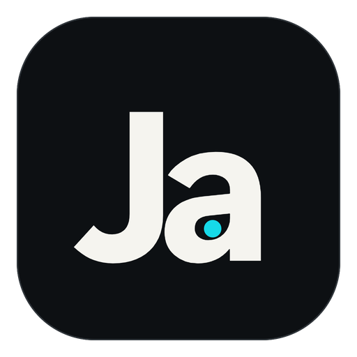
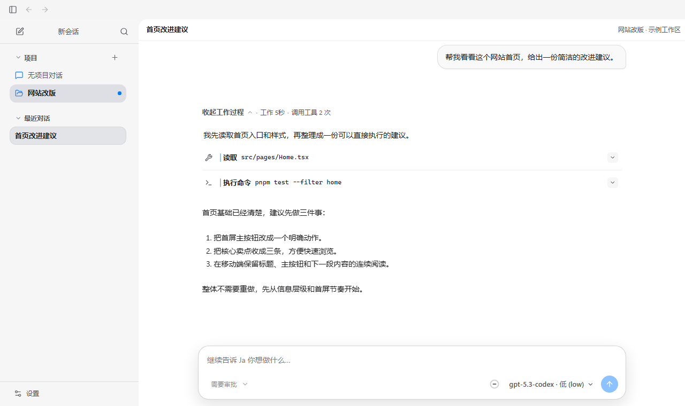
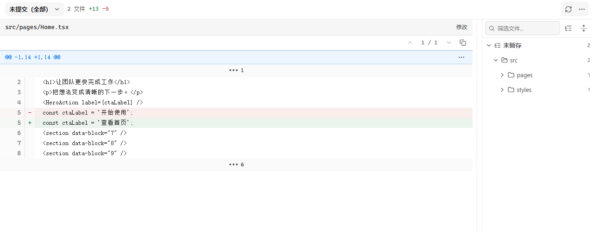

<!-- @author kongweiguang -->

<div align="center">
  
  <h1>Ja · 驾</h1>
  <p><strong>驾驭 Agent Harness，把想法变成可检查的结果。</strong></p>
  <p>运行在本机的开源 AI Agent 工作台，支持桌面端和 CLI。</p>
  <p>
    <a href="https://github.com/kongweiguang/Ja/releases/latest"></a>
    <a href="https://www.npmjs.com/package/@kongweiguang/ja"></a>
    <a href="LICENSE"></a>
  </p>
  <p>
    <a href="#安装桌面端">下载桌面端</a> ·
    <a href="#安装-cli">安装 CLI</a> ·
    <a href="#首次使用">首次使用</a> ·
    <a href="#可以做什么">功能一览</a> ·
    <a href="https://github.com/kongweiguang/Ja/issues">反馈建议</a>
  </p>
</div>

用自然语言让 Ja 读懂项目、修改代码、整理文档、执行命令。你可以在桌面窗口中查看文件与变更，也可以留在终端里交互，或用 `ja exec` 接入脚本。模型由你选择，工作过程可查看，执行可以停止，结果可以审查。

**桌面端与 CLI 可独立安装，也可搭配使用。** 同一台电脑、同一数据目录下，两端共享模型配置、项目和持久会话，不需要重复配置 API Key。

## 安装

### 安装桌面端

前往 [GitHub Releases](https://github.com/kongweiguang/Ja/releases/latest)，选择对应设备的安装包：

| 平台                  | 安装包文件名结尾           |
| --------------------- | -------------------------- |
| Windows 11 · x64      | `windows_x86_64-setup.exe` |
| macOS · Apple Silicon | `darwin_aarch64.dmg`       |
| macOS · Intel         | `darwin_x86_64.dmg`        |

桌面安装包已包含运行环境，**无需另装 Java、Rust 或 Node.js**。安装后打开 Ja 即可；桌面安装不会额外提供 `ja` 命令，需要终端入口时请单独安装 CLI。

> [!NOTE]
> Ja 仍处于早期阶段，重要项目请先备份或使用版本控制。当前 Windows / macOS 安装包没有系统代码签名或公证，首次打开可能出现系统安全提示；应用内更新仍验证独立的 Tauri updater 签名。请只从本仓库 Releases 下载，并按需核对随版本提供的 `SHA256SUMS`。

### 安装 CLI

当前 npm CLI 支持 **Windows 11 x64 + Node.js 24.x**，包名为 [`@kongweiguang/ja`](https://www.npmjs.com/package/@kongweiguang/ja)。安装 Node.js 24.x 后，在终端运行：

```powershell
npm install -g @kongweiguang/ja@latest
ja --version
ja setup
ja
```

`ja setup` 用于配置模型，已有桌面端配置时可以跳过。`ja` 默认在当前目录开始对话，也可以指定项目：

```powershell
ja -C "C:\projects\my-app"
```

CLI 包内包含原生 App Server 和文件搜索工具，无需另装 JDK、Rust、`fd` 或 `rg`。macOS 用户目前请使用桌面端；尚未提供 macOS / Linux 的 npm CLI 包，也没有 Linux 桌面安装包。

升级 CLI 使用同一条安装命令：

```powershell
npm install -g @kongweiguang/ja@latest
```

更多终端操作、自动化参数和卸载说明见 [CLI 使用指南](packages/ja-npm/README.md)。

## 首次使用

### 1. 接入你的模型

桌面端打开 **设置 → 模型 → 新增供应商**；CLI 运行 `ja setup`。填写供应商名称、API 规范、Base URL 和 API Key，然后添加服务商提供的**真实模型标识**，保存并选择默认模型。

支持的接口规范：

- Anthropic Messages
- OpenAI Chat Completions
- OpenAI Responses

可以配置多个供应商和模型，在会话中切换；CLI 使用 `/model`。上下文、单次最大输出 Tokens 与思考档位可按模型实际能力配置，不需要手改配置文件。连接有问题时，使用“验证模型”（桌面）或“验证连接”（CLI）；验证会发送真实模型请求，可能产生费用。

Ja 不要求注册 Ja 账号，也不附带模型订阅或 API 额度。模型服务由你选择，费用由对应服务商收取。

### 2. 选择项目，确认权限

桌面端可添加本地项目，也可选择“无项目对话”；CLI 在目标目录运行 `ja`。首次访问未受信任的项目时，先确认是否信任，项目配置和工具执行受信任状态约束。

首次尝试建议把执行确认切换为 **需要审批**，先让 Ja 只读分析。**完全访问**是默认模式，允许 Agent 直接使用当前用户的文件与命令权限；审批不等于操作系统沙箱。

### 3. 给它一个具体任务

> “先读一下这个项目，告诉我如何运行，暂时不要修改文件。”
>
> “给这个页面加一个搜索框，保持现有风格，完成后运行相关测试。”
>
> “把这份文档整理成一页说明，面向第一次使用的人。”

执行中可以查看工具记录、补充要求或停止任务；完成后检查回复与文件差异，再决定下一步。复杂任务可使用 `/plan` 先规划、确认方案，再执行。

## 可以做什么

- **在项目里完成任务**：读取与搜索文件、修改代码、执行命令、运行测试；引用文件和图片，给模型补充必要上下文。
- **在桌面里检查结果**：文件树、编辑器、代码审查、终端和浏览器预览集中在右侧工作台；每个会话保留自己的标签与内容。
- **在终端里持续协作**：恢复会话、切换模型、查看本轮差异、审查 Git 变更、复制或导出回答，也能通过脚本非交互执行。
- **先规划，再推进**：Plan 支持方案确认、执行、暂停、恢复与验收；独立工作可委派给子任务。
- **保留上下文，继续工作**：会话历史、回复分叉、运行中补充输入与上下文压缩，让后续工作接得上。
- **按需扩展能力**：Skills 提供可复用的工作方法，MCP 接入外部工具；桌面设置可管理全局及项目的 Skills / MCP，CLI 可用 `/skills`、`/mcp` 查看当前可用项。





_截图由当前桌面生产组件与全局样式渲染，使用示例数据，不包含真实用户对话或密钥；仅展示界面，不代表示例任务的实际执行结果。_

## CLI 常用命令

| 命令                        | 用途                                     |
| --------------------------- | ---------------------------------------- |
| `ja`                        | 在当前目录开始交互会话                   |
| `ja -C <目录>`              | 在指定项目中开始会话                     |
| `ja setup`                  | 管理全局供应商、模型、API Key 与默认模型 |
| `ja resume`                 | 选择已有会话继续                         |
| `ja resume --last`          | 继续当前范围内最近的会话                 |
| `ja resume <thread-id>`     | 按 ID 打开指定会话                       |
| `ja exec "任务内容"`        | 非交互执行，stdout 输出最终回答          |
| `ja exec --json "任务内容"` | 输出带会话身份和终态的 JSONL 事件        |
| `ja server status`          | 查看本机后台状态                         |

例如，在 Git 项目中把变更交给 Ja 审查：

```powershell
git diff | ja exec --permissions approval-required "检查这些变更，指出问题，暂时不要修改文件"
```

交互界面输入 `/` 查找命令、`@` 引用文件、`$` 选择 Skill。`/diff` 查看最近一轮的文件修改，`/review` 审查当前 Git 未提交变更；`Ctrl+J` 换行，空输入时 `Ctrl+D` 退出。

非交互执行如果需要审批或澄清，会返回会话标识并以退出码 `3` 结束；使用 `ja resume <thread-id>` 或桌面端继续处理。脚本应检查退出码与终态，不能把“请求已受理”当成“任务已完成”。完整参数见 `ja --help`、`ja exec --help` 和 [CLI 使用指南](packages/ja-npm/README.md)。

## 数据与安全

- **数据保存在本机**：对话、配置和附件默认位于 `~/.ja`，Windows 为 `%USERPROFILE%\.ja`。可通过 `JA_HOME` 指向另一个绝对目录；切换目录不会自动迁移原数据。
- **本机运行不等于完全离线**：相关对话、文件内容和附件会按任务需要发送到你选择的模型服务；MCP 与浏览器也可能访问外部服务。请只接入可信服务，并留意敏感资料。
- **退出窗口不等于取消任务**：桌面端和 CLI 共享后台。需要停止工作时，应明确取消任务；关闭终端只断开客户端连接。
- **分享前先脱敏**：不要公开 `auth.json`、API Key、私有对话或未经检查的日志。安全问题请参阅 [安全说明](SECURITY.md)。

## 常见问题

**必须同时安装桌面端和 CLI 吗？** 不需要。任选一种即可；同时安装时，使用同一个用户与 `JA_HOME` 即可共享配置和持久会话。建议保持两端版本一致。

**已经安装 CLI，但找不到 `ja`？** 先重新打开终端，检查 `node --version` 是否为 24.x，并确认 npm 全局可执行目录已加入 `PATH`。可运行 `npm prefix -g` 查看 Windows 的全局安装目录。

**如何更新桌面端？** 在 **设置 → 关于** 中检查更新，也可从 Releases 下载最新安装包。CLI 通过 npm 独立更新。

**从 0.1 升级到 0.2，需要注意什么？** 0.2 使用新的数据基线，不迁移旧数据库或旧会话。请先备份，并按 [v0.2.0 发布说明](https://github.com/kongweiguang/Ja/releases/tag/v0.2.0) 使用新的数据目录，不要直接删除原 `.ja`。

## 开发与贡献

“驾”取驾驭之意：驾驭 Agent Harness，也掌握任务的方向。核心 Harness 由 **Java 25** 实现，Ja App Server 使用 **Solon**；桌面端使用 **Tauri + React**，CLI/TUI 使用 **Rust**，两端复用同一套本地服务。

- [贡献指南](CONTRIBUTING.md)：工具链、开发启动、目录结构与验证。
- [Java 接入说明](ja-agent/README.md) 与 [Spring Boot 示例](ja-agent/example/ja-agent-example-springboot/README.md)：从源码复用 Agent Core；目前未发布到公共 Maven 仓库。
- [Issues](https://github.com/kongweiguang/Ja/issues)：报告问题或提出建议，请附版本、系统与复现步骤。

Ja 以 [GPL-3.0-or-later](LICENSE) 开源。
